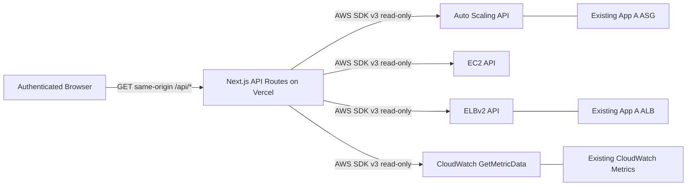

# 02 — Technical Requirements Document (TRD)

**ScaleOps Command Center · Application B · v1.0**  
**Read alongside:** `01-PRD-ScaleOps-Dashboard.md` · **Time budget:** 3 hours · **Deployment:** Vercel

## 1. Architectural decision

Build **one Next.js App Router project** with TypeScript, Tailwind CSS, server-side Route Handlers and AWS SDK v3. Browser only calls `/api/*` on its own origin; those routes use a **dedicated read-only AWS principal** to inspect Terraform-deployed App A. AWS controls scaling, not the dashboard. No database for the three-hour MVP. No WebSockets, cron, queues or background worker.



**No stateful server**: in-memory caches are best-effort per invocation only. UI polls when visible and stops when backgrounded; optional HTTP caching must be carefully bounded. Deploy on Node.js runtime, not Edge.

## 2. Repository architecture

```text
scaleops-dashboard/
  src/
    app/
      (protected)/layout.tsx
      (protected)/dashboard/page.tsx
      (protected)/infrastructure/page.tsx
      (protected)/events/page.tsx
      login/page.tsx
      api/auth/login/route.ts
      api/auth/logout/route.ts
      api/overview/route.ts
      api/infrastructure/route.ts
      api/events/route.ts
      api/health/route.ts
      layout.tsx
      globals.css
    components/
      shell/{sidebar,topbar,environment-strip}.tsx
      dashboard/{metric-tile,chart-panel,capacity-rail,health-summary}.tsx
      infrastructure/{instances-table,target-table}.tsx
      events/{event-row,events-timeline}.tsx
      ui/{button,skeleton,error-state,empty-state}.tsx
    lib/
      env.ts
      auth.ts
      aws/{clients,asg,ec2,elbv2,cloudwatch,metrics}.ts
      data/{normalize,schemas,format}.ts
      time.ts
  middleware.ts  # optional navigation redirect only; authorization MUST be enforced in handlers
  tests/{metric-dimensions,normalize,auth,api}.test.ts
  .env.example
  README.md
```

All AWS clients and secrets in `server-only` modules. Use `import 'server-only'` in `lib/aws/*` and authentication helpers.

## 3. Runtime dependencies

- `next`, `react`, `react-dom`, `typescript`, `tailwindcss` (compatible versions selected and locked at install).
- `@aws-sdk/client-auto-scaling`, `@aws-sdk/client-ec2`, `@aws-sdk/client-elastic-load-balancing-v2`, `@aws-sdk/client-cloudwatch`.
- `zod` for validation; `recharts` for SVG time-series; `lucide-react` for a sparse icon vocabulary.
- `jose` for signed, HTTP-only session cookies; optional test tooling `vitest`.

No Prisma, MongoDB client, ORM, Redis, Socket.IO or graph-generating LLM required.

## 4. Environment and identity

```dotenv
# Server-only, Vercel Production + Preview (never NEXT_PUBLIC_)
AWS_REGION=ap-south-1
AWS_ASG_NAME=scaleops-hackathon-asg
AWS_ALB_ARN=arn:aws:elasticloadbalancing:REGION:ACCOUNT:loadbalancer/app/NAME/ID
AWS_TARGET_GROUP_ARN=arn:aws:elasticloadbalancing:REGION:ACCOUNT:targetgroup/NAME/ID
AWS_ACCESS_KEY_ID=...                       # dedicated READ-ONLY dashboard user
AWS_SECRET_ACCESS_KEY=...                   # NOT Terraform deploy credentials
DASHBOARD_PASSWORD_HASH=...                 # scrypt/Argon2id or secure hash; never plain text in repo
SESSION_SECRET=...                          # strong random signing key
```

`AWS_SESSION_TOKEN` optional for temporary credentials. Region and names are examples only; replace with **actual `terraform output` values**. Validate env with Zod on the server. Vercel environment variables must be configured separately for the target environment. Keep any AWS credentials and protected session cookies out of API JSON/logs.

**IAM read actions (starting checklist)**: `autoscaling:DescribeAutoScalingGroups`, `autoscaling:DescribeScalingActivities`, `ec2:DescribeInstances`, `elasticloadbalancing:DescribeTargetHealth`, `cloudwatch:GetMetricData`. Optional `elasticloadbalancing:DescribeLoadBalancers`, `elasticloadbalancing:DescribeTargetGroups` only if discovery is implemented. Some `Describe*`/metric APIs require `Resource: "*"`; use account/region constraints where supported, and no write actions. This dashboard never needs `ec2:*` or the deployment IAM user's keys.

## 5. AWS API implementation & metric semantics

### 5.1 Auto Scaling and instance lifecycle

`AutoScalingClient + DescribeAutoScalingGroupsCommand({ AutoScalingGroupNames: [name] })` ⇒ selected ASG; error if not found. Record `MinSize`, `MaxSize`, `DesiredCapacity`, and `Instances` (`InstanceId`, `LifecycleState`, `HealthStatus`, `AvailabilityZone`). `inService` = count of `LifecycleState === 'InService'`, `pending` count by prefix `Pending`; neither is necessarily identical to ALB healthy targets.

`DescribeScalingActivitiesCommand({ AutoScalingGroupName: name, MaxRecords: 20 })` ⇒ `ActivityId`, `StartTime`, `EndTime`, `StatusCode`, `Cause`, `Description`, `Progress`; sort newest-first. Beware activities include instance replacement, refresh and health actions, **not only traffic-triggered scaling**.

`EC2Client + DescribeInstancesCommand({ InstanceIds: [...ASG ids] })` ⇒ optional `State.Name`, `PrivateIpAddress`, `InstanceType`, AZ. Skip for empty ASG. Handle recently terminated instance IDs disappearing as a partial result instead of 500-ing the entire page.

### 5.2 ALB target health

`ElasticLoadBalancingV2Client + DescribeTargetHealthCommand({ TargetGroupArn })` ⇒ `Target.Id`, `TargetHealth.State`, `Reason`, `Description`. Count states `healthy`, `unhealthy`, `initial`, `draining`, `unused`, `unavailable`; avoid equating unhealthy target count with ASG unhealthy instance count.

### 5.3 CloudWatch GetMetricData (exact definitions)

**Time window:** `range ∈ {1h,3h,6h}`; 60-second period for 1h/3h when underlying monitoring supports it, 300 seconds for 6h; filter/surface absence of data. CloudWatch EC2 basic monitoring may publish CPU points every **5 minutes**. Do not imply a 60-second reading exists without detailed monitoring.

A. **EC2 CPU, ASG average**: query `Namespace: AWS/EC2`, `MetricName: CPUUtilization`, `Dimensions: [{Name:'AutoScalingGroupName',Value: asgName}]`, `Stat: 'Average'`, `Unit: 'Percent'`, `Period: 60|300`. Verify this dimension and datapoints against your actual metrics; fallback explicitly to per-instance CPU metric queries (dimension `InstanceId`) and compute an explicitly labeled *mean of reporting instances* per timestamp, not an invented ASG aggregate. CloudWatch 1-minute vs 5-minute resolution depends on instance monitoring.

B. **ALB request volume**: `Namespace: AWS/ApplicationELB`, `MetricName: RequestCount`, `Dimensions: [{Name:'LoadBalancer',Value: albMetricDimension}]`, `Stat: 'Sum'`, `Period: 60|300`; unit `Count`. The `LoadBalancer` dimension must be derived from the ALB ARN suffix **`app/name/id`**, not the full ARN or DNS name. For time-range request total, sum returned period values; for request rate convert `sum / periodSeconds` explicitly.

C. **ALB target response time**: `AWS/ApplicationELB`, `TargetResponseTime`, `LoadBalancer` dimension above, `Stat:'Average'`, `Period: 60|300`. Unit from AWS is **seconds**, convert to milliseconds only with `×1000` and display clear `ms` label.

D. **ASG capacity charts (optional)**: `AWS/AutoScaling`, `GroupInServiceInstances` / `GroupDesiredCapacity` with `AutoScalingGroupName` dimension, statistic `Average`, when ASG group metrics collection has been enabled. **Do not require these metrics**; current capacity comes reliably from `DescribeAutoScalingGroups`.

Extract ALB suffix safely from validated ARN (`:loadbalancer/app/...`). `GetMetricData` returns timestamps and values arrays that must be zipped then sorted ASC by timestamp. Align missing values as `null`; never fill with zero. Some CloudWatch series can be absent until requests occur. AWS timestamps returned in UTC; show timestamps in user's chosen display timezone with explicit label.

### 5.4 Request volume vs current requests

`RequestCount` datapoints represent requests per metric period, not a literal instantaneous RPS. The UI must label **requests / 1 min** or **requests / 5 min** and identify selected range. Target response time is ALB back-end response time and not necessarily end-to-end page load time.

## 6. API boundary and contracts

All endpoints require authenticated session except health and login. `Cache-Control: private, no-store` for auth and sensitive live APIs. Use service-side request timeout (e.g. 6 s per parallel AWS request), short response body size, and `maxDuration` compatible with the Vercel plan. `Promise.allSettled` to retain partial panels when one service errors; return typed **panel-level** error states.

| GET endpoint | Query | Required payload | Notes |
|---|---|---|---|
| `/api/overview` | `range=1h\|3h\|6h` | metadata, asg capacity, target health, metric series, fetchedAt, partial errors | One fan-out call, parallelized |
| `/api/infrastructure` | none | ASG details, EC2 instance table, ALB target states, fetchedAt | never full SDK objects |
| `/api/events` | `limit=20` | real scaling activity list, fetchedAt | bound limit to 1–50 |
| `/api/health` | none | `{ status: 'ok' }` | only service liveness, NOT AWS success |
| `/api/auth/login` | POST password | secure session cookie | rate limit as feasible, generic failure |
| `/api/auth/logout` | POST | cookie cleared | CSRF-safe same-origin action |

All protected APIs reply 401 unauthenticated, 400 invalid range, 503 AWS unavailable (where all requested sources fail), 200 partial with `errors` when some succeed. Return standardized error codes `AWS_ACCESS_DENIED`, `AWS_RESOURCE_MISSING`, `AWS_THROTTLED`, `AWS_TIMEOUT`, `NO_DATAPOINTS`, `NOT_CONFIGURED`, without exposing SDK internals. See `04-BACKEND-SCHEMA-ScaleOps-Dashboard.md` for exhaustive typed models.

## 7. Auth design (hackathon-size, still real)

One shared demo login password is enough for read-only MVP; no user database. At `/api/auth/login`, verify password against `DASHBOARD_PASSWORD_HASH` with timing-safe semantics; issue `HttpOnly; Secure; SameSite=Lax` signed session cookie using `SESSION_SECRET`, expiration 8h. Every protected Route Handler calls `requireSession()` **server-side**. `middleware.ts` may redirect UI, but alone is insufficient. Never render AWS data in unauthenticated server-side HTML. Add `robots` noindex and discourage sharing credentials in demo recordings.

## 8. Polling, freshness and operational safety

- Browser polling interval **30 sec** when tab visible; pause when hidden; resume on focus; disable simultaneous overlapping fetches with AbortController.
- Show API retrieval time **and** most recent datapoint time; label metrics lag and last refresh failure.
- Client retains last successful result marked **STALE**, rather than silently clearing or showing it as fresh.
- Estimate AWS API load before live demo (e.g. 10 simultaneous viewers × 2 calls/minute creates ~20 overview polls/minute); handle `Throttling` with bounded retries/backoff, avoid unbounded retries. For demo with many viewers, consider a 15–30-second shared server-side response cache if compatible with session design.
- Never trigger k6 tests or AWS write operations from this app.

## 9. NFRs & acceptance tests

- **Truthfulness**: sample points exactly match CloudWatch timestamps; event IDs and status correspond to AWS.
- **Availability**: partial AWS failure does not crash other widgets.
- **Security**: password gate enforced by server API; no AWS admin keys anywhere; no secrets in browser or build output.
- **A11y**: semantic headings, keyboard navigation, text summaries for charts, no color-only status.
- **Visual quality**: no teal/mint/purple AI-SaaS gradients; implement `03-UI-UX-DESIGN` literally.
- **Testing**: unit tests for ALB ARN → dimension, CloudWatch sort/gaps, ASG state counts, session access, AWS errors; manual test in AWS account using real outputs.

## 10. Non-goals and future improvements

PostgreSQL / MongoDB, load-test session persistence, cost forecasts, LLM-based advice, alerts and organization management are **deferred**. Keep interface clean enough to add separate persistence later, but do not introduce unused schema migrations. No dashboard-triggered scale changes, deploy actions or user-managed AWS keys in MVP.

## 11. Handoff checklist

- [ ] Exact Terraform `asg_name`, `alb_arn`, `target_group_arn`, `region` verified.
- [ ] Read-only IAM credential tested for all five AWS read operations.
- [ ] Auth/session gate verified on all APIs.
- [ ] `AWS/ApplicationELB` load balancer dimension verified on real metric response.
- [ ] Missing CloudWatch data shown honestly, not faked.
- [ ] App deployed and tested on Vercel production URL.
