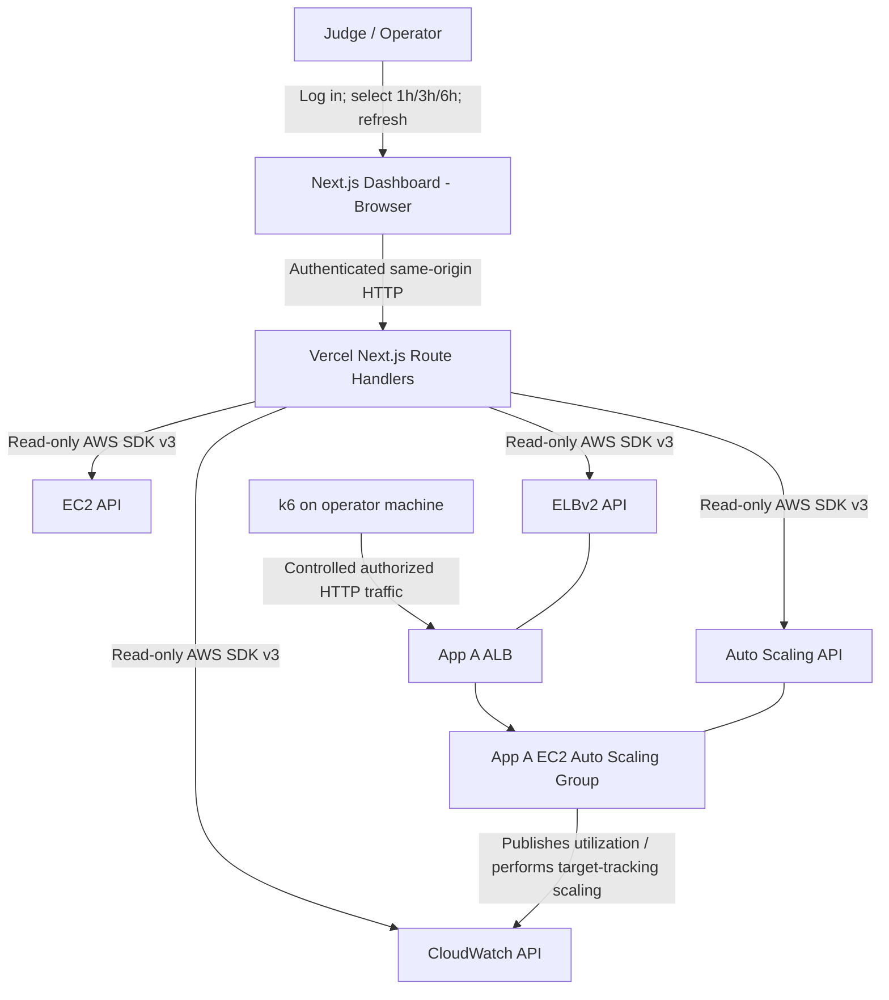
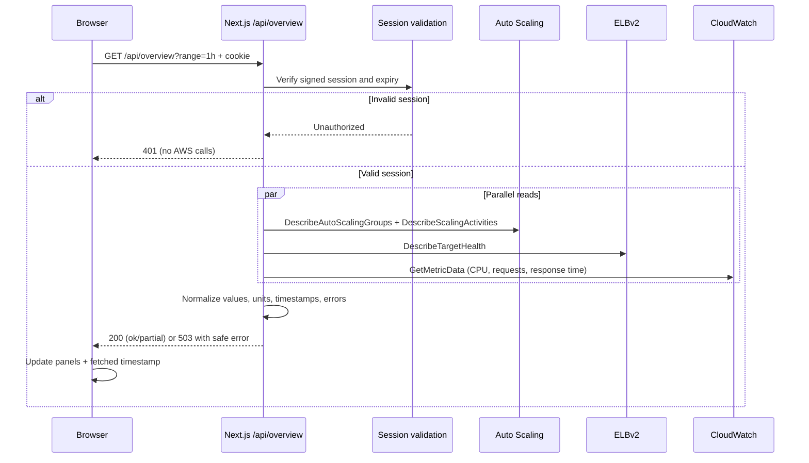
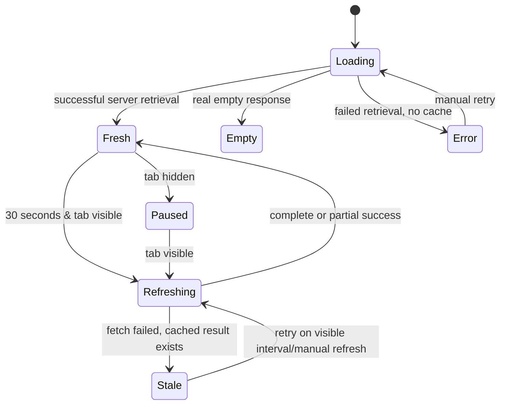
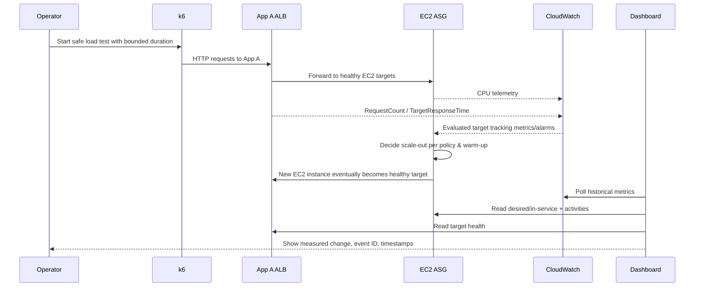

# 05 — Data Flow & System Interaction Design

**App B** is read-only. **App A** receives load. **AWS Auto Scaling** performs capacity changes. Keep these three responsibilities separate.

## 1. Context diagram



**Critical semantics:** App B neither sends test traffic nor issues `UpdateAutoScalingGroup` or `SetDesiredCapacity`. A scaling event occurs from AWS scaling policy and instance warm-up, not from the dashboard rendering a chart.

## 2. Authenticated overview fetch sequence



CloudWatch samples can predate `fetchedAt` by minutes. Show both times; never equate HTTP freshness with metric freshness.

## 3. Data transformation stages

| Stage | Input | Transform | Output | Failure |
|---|---|---|---|---|
| 1. Verify | signed cookie | validate signature/expiry | authorized user | 401 before AWS calls |
| 2. Configure | server env | Zod validation for region, ASG, ARN | immutable config | NOT_CONFIGURED |
| 3. Fetch capacity | ASG name | DescribeAutoScalingGroups | capacity, ASG instance IDs | access missing / ASG missing |
| 4. Fetch health | TargetGroup ARN | DescribeTargetHealth | target states/counts | partial health panel |
| 5. Fetch trends | range, metric dimensions | GetMetricData | timestamped series | no points / rate-limit |
| 6. Fetch events | ASG name | DescribeScalingActivities | event ledger | partial events panel |
| 7. Normalize | SDK outputs | time sort, unit conversion, safe strings | typed contract | sanitize field errors |
| 8. Render | typed JSON | React state + Recharts | time-series, capacity rail, ledger | stale/empty/error visuals |

## 4. Dashboard polling lifecycle



Rules: Abort pending request on navigation. No 30-second server-side infinite loop. Suppress overlapping requests. Reuse last successful result **only with visible STALE state**. Each chart includes newest datapoint timestamp.

## 5. Scaling demonstration — what actually changes



**Do not promise:** exact scale-out time, zero errors during scale-up, or that UI refresh itself triggers AWS scaling. Graphs might lag scaling events due to CloudWatch publication delay.

## 6. Route-specific flow

### `/dashboard`

1. Auth gate → overview route → parallel ASG/ELB/CloudWatch reads.
2. Construct `CapacitySnapshot`, `TargetSummary`, three `MetricSeries`, recent `ScalingEvent[]`.
3. Render capacity strip, charts and event excerpt.
4. Every 30 seconds poll overview if tab visible; range switch refetches.

### `/infrastructure`

1. Auth gate → describe selected ASG; extract instance IDs.
2. In parallel read ELB target health and `DescribeInstances` for those IDs only.
3. Left-join ASG lifecycle rows with EC2 details and ALB targets by instance ID.
4. Render concise table. Missing extra EC2 metadata yields null, not fabricated values.

### `/events`

1. Auth gate → `DescribeScalingActivities` with bounded count.
2. Map timestamps to ISO; order descending.
3. Render ledger including event status/cause as AWS returns it.

## 7. Security and trust boundaries

```text
UNTRUSTED WEB BROWSER  --cookie-->  TRUSTED NEXT.JS SERVERLESS ROUTE
                                   ├── session verification
                                   ├── env + query validation
                                   ├── AWS SDK auth (read-only identity)
                                   └── sanitized JSON output
                                           |
                                           v
                                   AWS CONTROL PLANE
```

No `NEXT_PUBLIC_AWS_*`. Never pass AWS secret key to browser. GitHub Terraform deploy credentials are distinct and must not be placed on Vercel. App A's public ALB does not grant access to AWS SDK; these are separate trust paths. Never create a dashboard endpoint to trigger arbitrary load or modify ASG just to impress judges.

## 8. Units and temporal correctness

- CPU: percentage, AWS `Average`, exact observation time.
- RequestCount: request **count per selected 60/300-second period**, AWS `Sum`, not instant RPS.
- TargetResponseTime: AWS `Average` in **seconds**; show ms only after explicit conversion.
- Scaling events: `StartTime/EndTime` as returned, not aligned to chart points by assumption.
- All transport timestamps ISO 8601 UTC; display timezone explicitly in frontend.
- Missing CloudWatch datapoints remain `null`/gaps, **never 0**.

## 9. Operational traceability

For demo evidence capture time-labeled screenshots of (1) k6 CLI test window, (2) CloudWatch CPU + ALB metrics, (3) scaling activities, (4) capacity/target health. A dashboard event can be correlated with a load-test window, but avoid stating causation unless ASG activity `Cause` and monitoring support it. Exports (if added) include `fetchedAt`, ASG, region, metric units and source.

## 10. Failure flows

| Event | Backend handling | Frontend outcome |
|---|---|---|
| Missing ASG | `AWS_RESOURCE_MISSING` | Explain wrong ASG/region; no zero-capacity lie |
| Invalid target group ARN | validation/AWS error | Infrastructure health unavailable |
| CloudWatch not yet populated | empty metric result | Empty chart + observation note |
| Rate limit | one bounded retry | Partial/stale data with timestamp |
| Expired session | 401 before AWS | Redirect to login, no metadata |
| Serverless cold start / timeout | safe 503 | Non-destructive error, manual retry |
| Instance terminates during fetch | left join with nulls | Show transition; no fatal exception |

## 11. Acceptance traces

- [ ] Network inspector: browser requests only first-party `/api/*`, no AWS credentials.
- [ ] ASG snapshot matches AWS Console when read near same time.
- [ ] 1h/3h/6h range changes metric query window.
- [ ] Permission failure causes a visible partial error, never fake metrics.
- [ ] AWS scaling event has an Activity ID and actual start timestamp.
- [ ] Pausing tab prevents new polling; returning resumes safely.
