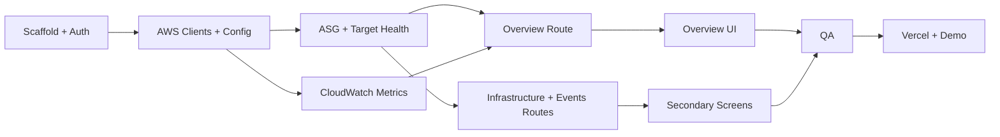

# 06 — Three-Hour Implementation Plan & Agent Execution Contract

**ScaleOps Command Center · App B · 180 minutes total**  
**Target:** protected live Next.js dashboard on Vercel reading **actual existing App A AWS resources**. **Ship P0 first.**

## 0. Immutable implementation rules

1. Build **App B only**. Do **not** modify App A, Terraform, GitHub Actions or scale policies.
2. No database or ORM in MVP: PostgreSQL/Atlas unnecessary for read-only AWS monitoring.
3. Use Next.js App Router + TypeScript + Tailwind + AWS SDK v3 + Recharts + Vercel.
4. Real data only; never fake CloudWatch metrics, dummy scaling events or arbitrary cost estimates.
5. Read-only dashboard IAM principal. Never deploy Terraform IAM credentials to Vercel.
6. Auth gate on UI **and APIs**. No `NEXT_PUBLIC_` AWS secrets.
7. Follow `03-UI-UX-DESIGN-ScaleOps-Dashboard.md` exactly: graphite/paper/cobalt/copper, no teal, gradients, glass cards, generic SaaS styling.
8. Show both fetch time and newest CloudWatch sample time, because metric publication lags.
9. Call out actual test status and blockers. Never claim successful AWS API calls without evidence.

## 1. Dependencies before timer starts (5-minute operator checklist)

From App A `terraform output` or AWS Console get:

- `AWS_REGION`
- `AWS_ASG_NAME`
- `AWS_ALB_ARN`
- `AWS_TARGET_GROUP_ARN`

Confirm there is at least one healthy App A ALB target and that AWS credentials available for dashboard are **read-only**. Set deployment secrets in Vercel, not source control. Need Vercel project and repository access. If AWS output missing, start scaffold/UI with honest **NOT_CONFIGURED** state (no fake numbers), then wire later.

## 2. Minute-by-minute delivery plan

| Clock | Goal | Deliverable / verification |
|---|---|---|
| 00:00–00:15 | Scaffold & design tokens | Next.js, Tailwind, fonts, routes, `.env.example`; `npm run build` success |
| 00:15–00:30 | Auth & config | Server-only Zod env; session cookie; `/api/health`; unauthorized API returns 401 |
| 00:30–01:10 | Real AWS backend | ASG capacity+events, ELB target health, CloudWatch GetMetricData; serializable typed response |
| 01:10–01:45 | Overview UI | Environment strip, capacity rail, CPU + requests plots, activity excerpt, 30s polling |
| 01:45–02:10 | Auxiliary pages | `/infrastructure` and `/events`; actual AWS lists; empty/error states |
| 02:10–02:30 | Correctness & QA | Check dimensions, sample times, units, partial errors, session protection, responsive |
| 02:30–02:45 | Production deploy | Set Vercel env; deploy; verify production authenticated API reads |
| 02:45–03:00 | Live rehearsal | Compare with AWS Console; load-test window; capture credible screenshots |

**Time guard:** At 01:30 if CloudWatch metrics still absent, validate `LoadBalancer` dimension and monitoring period rather than drawing simulated series. At 02:10 if secondary pages not working, prioritize one rock-solid overview; simplify `Infrastructure`/`Events` to bare tables. No extra AI chat/cost forecast.

## 3. Implementation task graph



Parallel agent work is possible only after agreeing on types (`04-BACKEND-SCHEMA`) and layout tokens (`03-UI-UX-DESIGN`). Avoid multiple agents editing `layout.tsx` or `globals.css` simultaneously.

## 4. Detailed work packages and acceptance checks

### WP-01 Scaffold (15m)

- Initialize Next.js App Router, TypeScript, Tailwind and `recharts`.
- Create route group and navigation; CSS tokens exactly from design spec.
- Add `.env.example` with placeholder non-secret example names, `.gitignore`, basic project README.
- **Pass:** `npm run build` succeeds; route shell rendered on desktop/mobile.

### WP-02 Secure backend skeleton (15m)

- Server-only env validation and AWS SDK clients.
- Password verification against hashed server-side value; secure signed cookie with expiry.
- Server-side route-level authorization; login/logout; no resource IDs in unauthenticated response.
- **Pass:** `curl /api/overview` without session returns 401; login succeeds with correct local test secret.

### WP-03 AWS data services (40m)

- Implement ASG `DescribeAutoScalingGroups` and `DescribeScalingActivities`.
- Implement target health `DescribeTargetHealth`.
- Implement CloudWatch `GetMetricData` queries: CPU ASG dimension where valid / per-instance fallback, ALB `RequestCount` (Sum), `TargetResponseTime` (Average seconds).
- Derive `LoadBalancer` metric dimension from ALB ARN path `app/name/id`.
- Map timestamps and metric values; preserve missing datapoints. Use parallel calls and panel error normalization.
- **Pass:** returned JSON values match actual AWS control plane and each metric query's correct dimension; invalid resource yields actionable error.

### WP-04 Overview + live refresh (35m)

- Environment strip, capacity rail, plotted CPU and requests, recent scaling events.
- 1h/3h/6h time selector; 30-sec visible-tab polling; manual refresh.
- Show `source`, `fetchedAt`, latest metric sample time, error/empty/stale states.
- **Pass:** refresh updates real data, hidden tab stops requests, no fake graphs.

### WP-05 Infrastructure and events (25m)

- ASG instance table and ALB target table with states/reasons.
- Scaling activity ledger with actual AWS statuses, causes and start/end UTC timestamps.
- **Pass:** ASG state not incorrectly equated to ALB target health; no backend mutation endpoints.

### WP-06 Verification (20m)

- Unit tests for ARN parsing, periods, sort/normalization, missing data, event chronology, authorization.
- Lint/typecheck/build; inspect browser for secret leaks.
- Check no date/units mixups or unlabeled empty data.
- **Pass:** build clean; 401 outside session; partial failure doesn't crash page.

### WP-07 Vercel & demo (30m)

- Configure Vercel Production env, deploy to own project, verify protected login and actual AWS read calls.
- Compare same-time ASG count + ALB healthy targets to AWS Console.
- Trigger **authorized k6 externally on App A** if load testing already prepared; watch observed chart/event changes after metrics publication. Record screenshots. Do not promise scale-out within a fixed demo minute.
- **Pass:** production URL authenticated, no sensitive metadata public, live data verifiable.

## 5. Environment / run commands

```bash
npm install
cp .env.example .env.local
# fill SERVER-ONLY variables with actual App A AWS outputs
npm run dev
npm run build
npm run test
```

Vercel: link repo → set environment variables → deploy. AWS credential policies must be scoped to read-only calls. Do not commit `.env.local`, `terraform.tfstate` or screenshots containing secrets.

## 6. Runbook: how to validate against AWS

1. `aws sts get-caller-identity` on operator machine to confirm correct account (do not paste account IDs into public screenshots).
2. `aws autoscaling describe-auto-scaling-groups --auto-scaling-group-names "$AWS_ASG_NAME" --region "$AWS_REGION"` and compare desired/in-service with dashboard.
3. `aws autoscaling describe-scaling-activities --auto-scaling-group-name "$AWS_ASG_NAME" --region "$AWS_REGION" --max-items 10` and match Activity IDs/times.
4. `aws elbv2 describe-target-health --target-group-arn "$AWS_TARGET_GROUP_ARN" --region "$AWS_REGION"` and match target states.
5. Check CloudWatch metric series dimensions and timestamps via Console or CLI. Do not expect CPU datapoints instantly; EC2 basic monitoring can be 5-minute granularity.
6. If no data, increase time window and check exact `LoadBalancer` dimension and whether monitoring is active.

## 7. MVP ship gates (binary)

| Gate | Mandatory evidence |
|---|---|
| G1 Auth | Direct unauthenticated `/api/overview` call returns 401 |
| G2 AWS identity | Read-only IAM identity and correct ASG/region configured |
| G3 Capacity | Min/desired/max and in-service values sourced from AWS |
| G4 Health | ALB target states sourced from `DescribeTargetHealth` |
| G5 Telemetry | Real CloudWatch CPU and request series or **honest no-data state** |
| G6 Events | Actual ASG activity list or honest empty history |
| G7 UX | Distinctive control-room styling; responsive; no fake content |
| G8 Vercel | Production protected routes and server-side AWS API connectivity |

**Working AWS dashboard cannot honestly be certified 100% functional until G1–G8 are observed.**

## 8. Bugs & diagnosis guide

| Symptom | Likely cause | Fix |
|---|---|---|
| 403 from AWS | Dashboard IAM policy incomplete | Add **specific read action** only, not Admin access |
| Missing ALB request metrics | Used full ARN instead of `app/name/id` | Correct dimension; verify traffic generated |
| CPU chart blank | AWS 5-min CPU period / no samples / dimension mismatch | Try 3h with 300s period, inspect metric dimensions |
| Healthy target differs from ASG InService | ALB health checks still running | Show as separate true signals |
| Vercel build includes AWS credentials | Secrets imported into client component | Move AWS SDK into `server-only` module |
| Polling floods endpoints | Timer created repeatedly | Single cleanup-able effect; pause when hidden |
| Events indicate instance refresh | Misread as load-based scale-out | Render AWS-provided cause verbatim |
| Reload logs out | Cookie signing/env mismatch | Stable `SESSION_SECRET`, secure cookie settings |

## 9. Agent handoff prompt (paste into coding agent)

> Implement ScaleOps Command Center **Application B only** by following the six local docs in numeric order. Scope is Next.js App Router dashboard deployed to Vercel with server-only AWS SDK v3 read-only integration to App A ASG, ALB and CloudWatch. Complete P0 within three hours. Use `04-BACKEND-SCHEMA` for exact API types, `05-DATAFLOW` for trust boundaries, `03-UI-UX-DESIGN` for graphite/paper/cobalt/copper control-room design. No database, no mock live values, no teal AI-generated SaaS styling, no infrastructure mutations. Implement login, overview, infrastructure, events, real error/empty/stale states, polling and timestamps. Test locally; do not claim AWS integration succeeded without observed responses. Finally list required Vercel env vars and deployed validation steps. Prioritize correctness over extras.

## 10. Stop conditions and post-hackathon extras

At time limit, ship verified P0. Do not start AI recommendations, cost projection, cross-account management, role editor, alerts, live WebSocket transport, PostgreSQL/Atlas, multiple regions, large authentication framework or Terraform dashboard integration. These do not increase milestone coverage quickly enough for a 3-hour build.
